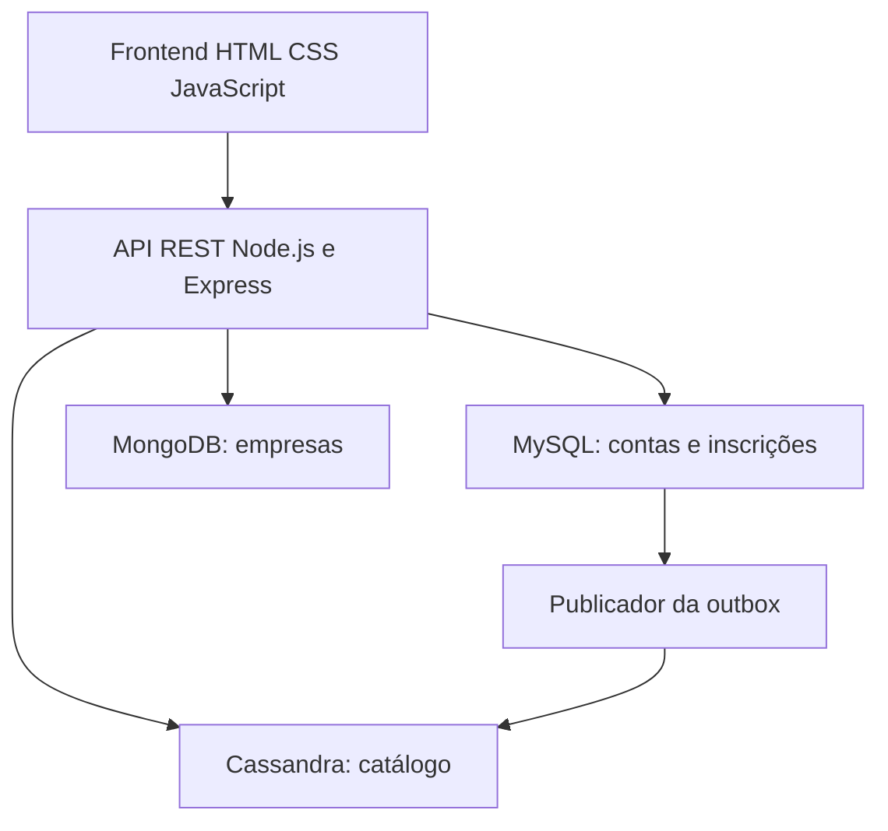

# EventFlow — Plataforma de Gestão de Eventos

Projeto acadêmico de **Performance e Tunning de Dados — Polyglot Persistence**.
Aplicação completa com frontend, backend e três bancos reais: **MySQL, MongoDB e Apache Cassandra**.

- Lucas de Almeida Brandão, 22.124.066-6.
- Luan Garcia Candido, 22.225.022-7.

## 1. Tema e funcionalidades

O EventFlow conecta participantes a empresas organizadoras. O usuário pode criar uma conta, explorar eventos por mês, confirmar uma inscrição, editar uma observação pessoal e cancelar a inscrição. O organizador cadastra sua empresa, publica eventos e gerencia sua agenda.

- CRUD da própria conta, com senha protegida e sessões persistentes.
- CRUD de empresa organizadora, com endereço e especialidades em documento.
- CRUD de eventos, com data, categoria, cidade, local, capacidade e preço informativo.
- CRUD de inscrições: confirmar, consultar, editar observação e cancelar.
- Controle transacional de vagas e prevenção de inscrições duplicadas.
- Interface responsiva em português, filtros, diálogos, estados vazios e mensagens de erro.
- Publicação assíncrona recuperável no Cassandra por meio de uma outbox.

O preço é informativo. O sistema **não processa pagamentos**, não valida CNPJ na Receita e não envia e-mails. O CNPJ é validado por formato (14 dígitos). Cada conta pode ter uma empresa.

## 2. Executar do zero

### Pré-requisitos

- Docker Engine com Docker Compose v2, ou Docker Desktop em execução.
- Conexão com a internet no primeiro build para baixar imagens e dependências.
- Como ponto de partida, disponibilize 6 GB de RAM para o Docker e aproximadamente 5 GB de disco. O consumo varia por plataforma.
- Porta 3000 livre. Nenhuma conta de Atlas ou Astra e nenhuma instalação local dos bancos é necessária.

Extraia este projeto, abra um terminal **na pasta que contém `compose.yaml`** e execute:

```bash
docker compose up -d --build --wait --wait-timeout 600
```

Abra **http://localhost:3000**. A primeira inicialização do Cassandra pode levar alguns minutos.

```bash
docker compose ps
docker compose logs -f app
```

As tabelas SQL/CQL e índices do MongoDB são criados automaticamente pela aplicação. A inicialização é idempotente. Não existem contas ou dados pessoais pré-carregados: use **Entrar → Criar uma conta** e depois **Organizar → Cadastrar empresa**.

### Configuração opcional

As configurações padrão são suficientes para a demonstração local. Para alterá-las, copie `.env.example` para `.env` e ajuste `PORT`, `MYSQL_PASSWORD` e `MYSQL_ROOT_PASSWORD`. Por exemplo:

```bash
cp .env.example .env
```

No Windows, a cópia também pode ser feita pelo Explorador de Arquivos. Se mudar a porta para 3001, abra http://localhost:3001. Alterar senhas após criar o volume MySQL não muda automaticamente a senha já armazenada no banco; use as credenciais originais ou altere-as no próprio MySQL.

### Parar, reiniciar e apagar

```bash
docker compose stop             # para e preserva os dados
docker compose start            # retoma os mesmos serviços
docker compose down             # remove containers, preserva volumes
```

**Somente para apagar todos os dados e começar novamente:**

```bash
docker compose down -v
```

## 3. Arquitetura e backend



O backend é um **monólito modular**. A divisão em três serviços no enunciado é um exemplo, não uma obrigação. Uma API central coordena autenticação, autorização e regras de negócio, enquanto os drivers especializados acessam cada banco. O frontend só conversa com a API; nunca acessa bancos diretamente.

| Arquivo | Responsabilidade |
|---|---|
| `src/app.js` | API REST, autorização e operações de negócio |
| `src/stores.js` | Conexões, inicialização, transações e publicador |
| `src/validation.js` | Validação e normalização das entradas |
| `src/security.js` | Hash de senhas e identificação das sessões |
| `src/server.js` | Inicialização, publicação periódica e encerramento |
| `public/` | Interface web sem build ou CDN |
| `db/` | Esquemas MySQL e Cassandra |
| `test/` | Testes automatizados e integração |

### MySQL — integridade e transações

Armazena usuários, sessões, inscrições, um registro mínimo de capacidade dos eventos e tarefas de publicação pendentes. E-mail é único; inscrições possuem chave composta `(user_id, event_id)` e referências SQL válidas.

O registro de capacidade contém apenas identidade, proprietário, empresa, mês, vagas e estado de sincronização. A descrição, local, categoria e preço do evento são consultados no Cassandra. O payload completo na outbox é **temporário** e removido após a publicação.

A inscrição usa uma transação InnoDB e `SELECT ... FOR UPDATE` no registro do evento. O sistema verifica a disponibilidade, insere a inscrição e incrementa a ocupação na mesma transação. Duas requisições concorrentes não conseguem reservar a mesma última vaga. A capacidade não pode ser reduzida abaixo da ocupação existente.

### MongoDB — perfis de organizadoras

Um documento reúne o perfil completo da empresa: nome, CNPJ, contato, descrição, endereço embarcado e uma lista variável de especialidades. Esses dados costumam ser lidos juntos e podem evoluir sem a decomposição em diversas tabelas e junções.

Há índices únicos para `cnpj` e `ownerId`. A aplicação valida os campos antes de gravar: flexibilidade documental não significa ausência de regras. A escolha é adequada ao perfil agregado, embora um banco relacional também pudesse representar esses dados.

### Cassandra — catálogo orientado às consultas

O modelo foi desenhado a partir de duas consultas:

| Consulta | Tabela | Chave de partição | Agrupamento |
|---|---|---|---|
| Abrir um evento ou compor uma inscrição | `events_by_id` | `id` | — |
| Explorar eventos de um mês em ordem cronológica | `events_by_month` | `month` | `starts_at`, `id` |

O documento do evento é duplicado nessas projeções. Todas as consultas de catálogo informam a chave de partição: não usamos `ALLOW FILTERING` nem varredura global. A consulta mensal é paginada em blocos de 50; a busca textual da tela atua sobre os resultados já carregados. O filtro mensal usa **UTC**; a exibição de horário usa o fuso do navegador.

A agenda do organizador obtém os IDs pelo índice SQL de proprietário e recupera cada evento pela chave no Cassandra. Essa composição é feita na aplicação.

A escolha demonstra desnormalização e acesso previsível por partição, com potencial de distribuição. Um único nó local não demonstra alta disponibilidade nem prova superioridade de desempenho. Uma partição mensal pode crescer muito; em escala maior, seria necessário combinar mês com região ou buckets. O payload textual simplifica o exemplo, mas campos CQL tipados seriam melhores para consultas mais especializadas.

## 4. Consistência, concorrência e recuperação

Não existe uma transação ACID global envolvendo os três bancos.

1. Ao criar ou editar evento, MySQL confirma o registro de capacidade e a tarefa de publicação juntos.
2. A API responde **202 Accepted**. A tela informa que a publicação está em processamento.
3. A cada dois segundos, o publicador lê a próxima tarefa com bloqueio transacional.
4. Um batch com log escreve as duas projeções Cassandra. Se a data mudou, remove a chave antiga.
5. Após confirmação, MySQL marca o registro sincronizado e remove a tarefa. Se houver falha, a tarefa permanece para nova tentativa.

O publicador processa uma tarefa por vez. Cada evento aceita apenas uma alteração pendente, evitando que uma versão antiga sobrescreva uma nova. As operações são repetíveis por chave. O batch Cassandra não é apresentado como uma transação distribuída entre bancos e não garante isolamento de leitura entre todas as partições. A API oculta eventos pendentes no catálogo público; requisições concorrentes que já estavam em andamento ainda podem observar o estado anterior.

Um evento só aceita inscrição quando está sincronizado e ainda não começou. A exclusão é bloqueada enquanto existirem inscritos. Uma empresa só pode ser removida depois que seus eventos forem excluídos e sincronizados. Uma conta só pode ser removida depois de cancelar as inscrições e excluir sua empresa.

A relação entre o usuário SQL e o documento MongoDB é verificada pela aplicação. Operações da empresa e exclusão da conta usam o mesmo bloqueio de usuário SQL. Ainda existe uma janela de falha entre bancos: uma gravação MongoDB pode ter sido aplicada mesmo que a resposta se perca. Consulte o perfil antes de repetir; os índices únicos evitam duplicação. Uma implantação maior exigiria reconciliação/outbox também para o ciclo de vida da empresa.

A outbox evita perder alterações pendentes no catálogo, mas não é backup. Perder os volumes exige restauração de backups. O primeiro job que falhar bloqueia os seguintes nesta versão; isso favorece simplicidade e ordem, com custo de disponibilidade. Produção exigiria filas por entidade, métricas, backoff e tratamento de mensagens inválidas.

### Segurança e limites de implantação

- Senhas com `scrypt`, salt aleatório e comparação em tempo constante.
- Tokens aleatórios; somente o hash da sessão é persistido no banco.
- Cookie `HttpOnly`, `SameSite=Strict`, com expiração de 12 horas.
- SQL/CQL parametrizados, validação de tipos e limite de corpo HTTP.
- Mutações exigem cabeçalho próprio, sem habilitar CORS.
- Controle de propriedade: só o dono pode alterar empresa e eventos.
- Conteúdo digitado pelo usuário é escapado antes de aparecer na interface.
- Limite de tentativas por IP para cadastro/login, em memória e por processo.

O Compose é **para uso acadêmico local**: apenas a aplicação é publicada em `127.0.0.1`; bancos ficam na rede interna, sem portas no host. MongoDB e Cassandra locais não têm autenticação configurada. Não publique esse Compose diretamente na internet. Uma implantação pública exige HTTPS, `COOKIE_SECURE=true`, segredos fortes, autenticação nos bancos, backups e política de acesso. Os volumes dão persistência após reiniciar, não tolerância à perda da máquina.

### Uso, justificativa e vantagens dos bancos de dados

O EventFlow adota **persistência poliglota**: cada banco foi escolhido conforme os dados que armazena e as operações que precisa atender.

| Banco | Onde é usado | Por que foi escolhido | Vantagem no EventFlow |
|---|---|---|---|
| **MySQL — relacional** | Contas, sessões, inscrições e controle de vagas. | As inscrições relacionam usuários e eventos. Confirmar uma inscrição e atualizar a ocupação são operações que precisam acontecer na mesma transação. | Mantém a integridade dos dados e evita que duas pessoas ocupem a mesma última vaga, mesmo quando solicitam a inscrição ao mesmo tempo. |
| **MongoDB — orientado a documentos** | Perfis das empresas organizadoras, com nome, contato, endereço e especialidades. | Esses dados costumam ser consultados juntos e podem ser armazenados em um único documento por empresa. | Permite recuperar o perfil completo sem `JOIN` e incluir campos opcionais conforme o perfil evolui. |
| **Cassandra — wide-column** | Catálogo de eventos publicados, consultado por mês ou por ID. | Cada consulta tem uma tabela própria: `events_by_month`, com partição por mês, e `events_by_id`, com partição por ID. | Permite consultar diretamente a partição correspondente sem percorrer o catálogo inteiro. Para atender aos dois padrões de consulta, os dados do evento são gravados nas duas tabelas. |

### Por que estes bancos foram escolhidos?

- **MySQL para inscrições e vagas.** A confirmação de uma inscrição precisa registrar o participante e atualizar a ocupação do evento na mesma transação. O MySQL permite bloquear o registro do evento durante essa operação, evitando que duas pessoas ocupem a última vaga. O PostgreSQL também atenderia a esse requisito; a escolha foi usar um banco relacional com suporte a transações e restrições de integridade.
- **MongoDB para perfis de empresas.** Endereço, contato e especialidades costumam ser exibidos juntos. Um documento por empresa permite recuperar o perfil completo em uma consulta e adicionar campos opcionais conforme necessário. No MySQL, também seria possível modelar esse perfil, mas o MongoDB permite armazená-lo diretamente na estrutura usada pela aplicação.
- **Cassandra para o catálogo de eventos.** O site faz duas consultas principais: listar eventos por mês e buscar um evento pelo ID. O Cassandra permite criar uma tabela para cada consulta, usando o mês ou o ID como chave de partição. MySQL e MongoDB também poderiam atender a essas consultas com índices. A escolha do Cassandra permite demonstrar a modelagem orientada às consultas, com o custo de gravar os dados do evento em duas tabelas.

Um único banco poderia atender ao tamanho atual do projeto. A escolha dos três faz parte da proposta de **persistência poliglota**: aplicar modelos diferentes conforme as necessidades de cada parte do sistema.

### Como cada banco ajuda nas funções do EventFlow

- **MySQL — cadastro, login e inscrições.** Guarda as contas e sessões usadas para acessar o sistema. Quando alguém confirma ou cancela uma inscrição, o MySQL atualiza a inscrição e a ocupação do evento na mesma transação. Assim, o número de vagas disponíveis acompanha as inscrições, mesmo quando duas pessoas tentam reservar a última vaga ao mesmo tempo.
- **MongoDB — cadastro e edição de empresas.** Guarda o perfil de cada organizadora em um único documento. Quando o organizador abre o perfil para consultar ou editar, a aplicação recupera nome, contato, endereço e especialidades juntos, sem precisar montar o perfil com junções.
- **Cassandra — publicação e consulta de eventos.** Quando o organizador publica ou edita um evento, os dados são gravados de forma assíncrona no catálogo. A tela **Explorar** consulta `events_by_month` para exibir os eventos do mês selecionado, enquanto o backend usa `events_by_id` para recuperar um evento específico. Cada consulta acessa diretamente a partição correspondente.

### Comparação com outros bancos de dados

| Função no EventFlow | Banco atual | Alternativa | O que mudaria |
|---|---|---|---|
| **Contas, inscrições e controle de vagas** | **MySQL** | **PostgreSQL** | O PostgreSQL também permite registrar a inscrição e atualizar a ocupação na mesma transação, com bloqueio para proteger a última vaga. A regra de negócio continuaria igual; seria necessário adaptar a conexão e os trechos de SQL específicos do MySQL. |
| **Perfis das empresas** | **MongoDB** | **MySQL** | O MySQL poderia guardar o perfil em colunas e representar as especialidades em uma tabela relacionada ou em um campo JSON. Com tabelas separadas, a consulta precisaria reunir esses dados. No MongoDB, endereço e especialidades ficam no mesmo documento e são recuperados juntos. |
| **Catálogo de eventos por mês e por ID** | **Cassandra** | **PostgreSQL** | No PostgreSQL, os eventos poderiam ficar em uma única tabela, com chave primária para a busca por ID e um índice na data para a consulta mensal. No Cassandra, cada consulta tem uma tabela própria e acessa a partição correspondente. Isso torna o caminho de leitura explícito, mas exige gravar e manter o evento nas duas tabelas. |

Para o volume atual do EventFlow, **um único banco relacional também poderia atender ao projeto** e simplificaria a operação. A arquitetura com três bancos foi escolhida para demonstrar **persistência poliglota** na prática: transações para inscrições, documentos para perfis e modelagem por consulta para o catálogo. Essas vantagens são de modelagem; sem benchmarks, não é possível afirmar que a arquitetura atual é mais rápida.

### Alternativa inadequada: substituir o MySQL pelo Cassandra nas inscrições

Usar o Cassandra com o mesmo modelo do MySQL não atenderia à regra da **última vaga**. No EventFlow, o MySQL verifica a disponibilidade, grava a inscrição e atualiza a ocupação na mesma transação, com bloqueio no registro do evento. Assim, duas pessoas não conseguem reservar a mesma última vaga.

Se essas etapas fossem executadas como operações independentes no Cassandra, duas requisições poderiam ler que ainda há uma vaga e confirmar duas inscrições. Seria possível redesenhar o modelo para usar operações condicionais, mas isso mudaria a forma de armazenar e controlar as reservas. Por isso, o EventFlow usa **MySQL para inscrições e vagas** e **Cassandra para o catálogo de eventos**.

### Outras alternativas inadequadas para o EventFlow

| Alternativa | Por que seria inadequada |
|---|---|
| **Usar Redis apenas como cache para guardar inscrições** | Se o cache perder os dados ou as chaves expirarem, o sistema pode perder inscrições confirmadas. O Redis pode ajudar a acelerar consultas, mas um cache descartável não deve ser a única fonte de dados das reservas. |
| **Usar Cassandra para os perfis de empresas mantendo apenas uma tabela com chave por ID** | O EventFlow precisa localizar empresas pelo **CNPJ** e pelo **ID do proprietário**. Uma tabela organizada somente pelo ID da empresa não atende diretamente a essas duas consultas. Seria necessário criar estruturas adicionais e manter os dados sincronizados. |
| **Usar um banco de grafos para o catálogo de eventos** | As consultas principais são **listar eventos por mês** e **buscar um evento por ID**. Um banco de grafos poderia atendê-las, mas sua principal vantagem, percorrer relacionamentos, não seria aproveitada. Ele faria mais sentido se o projeto recomendasse eventos a partir de conexões entre participantes, empresas e interesses. |

Essas alternativas são inadequadas **para a função e a configuração descritas**. A escolha depende das consultas que o sistema faz e das garantias que cada operação exige.

## 5. Endpoints

Mutações enviam JSON e o cabeçalho `X-Requested-With: EventFlow`. Rotas privadas usam o cookie da sessão.

| Método | Endpoint | Operação |
|---|---|---|
| POST | `/api/users` | Criar conta |
| POST | `/api/login` | Iniciar sessão |
| POST | `/api/logout` | Encerrar sessão |
| GET / PUT / DELETE | `/api/me` | Consultar, alterar e excluir a própria conta |
| GET / POST / PUT / DELETE | `/api/company` | CRUD da própria empresa |
| GET | `/api/events?month=AAAA-MM&cursor=...` | Catálogo público paginado |
| GET | `/api/my-events` | Agenda e estado de publicação do organizador |
| POST | `/api/events` | Criar evento |
| PUT / DELETE | `/api/events/:id` | Alterar/excluir evento próprio |
| POST | `/api/events/:id/registrations` | Confirmar inscrição |
| GET | `/api/registrations` | Consultar inscrições próprias |
| PUT / DELETE | `/api/registrations/:id` | Editar observação/cancelar inscrição |
| GET | `/api/health` | Verificar os três bancos |

`201`: criação imediata; `202`: publicação assíncrona; `400`: entrada inválida; `401`: sessão ausente; `403`: falta de autorização; `404`: recurso inexistente; `409`: conflito; `429`: limite de tentativas; `503`: indisponibilidade.

## 6. Testes e evidências

Com Node.js 22 ou superior, sem bancos:

```bash
npm ci
npm test
```

Os testes cobrem validação, senhas, commits/rollbacks, retry da publicação, mudança de chave no Cassandra, proteções HTTP e fluxos de interface em DOM simulado (jsdom). Usam substitutos controlados apenas onde o banco é necessário; não comprovam a execução dos bancos reais.

Com o Compose já saudável:

```bash
docker compose exec app node --test test/core.test.js
docker compose exec app npm run test:integration
```

O teste integrado cria registros temporários, executa CRUDs, verifica autorização, disputa a última vaga, aguarda a sincronização Cassandra e limpa os registros que criou. Execute numa base de demonstração: ele cria e remove os próprios dados de teste. O fluxo de integração contínua em `.github/workflows/ci.yml` sobe os três bancos e executa esse teste em um runner GitHub com Docker.

## 7. Roteiro rápido de demonstração

1. Crie uma conta de organizador, entre e cadastre uma empresa fictícia.
2. Publique um evento futuro com uma vaga. Aguarde desaparecer a indicação de processamento.
3. Confira o catálogo no mês correspondente. Abra outra janela anônima, crie um participante e confirme a inscrição.
4. Mostre as inscrições, altere a observação e tente excluir o evento pelo organizador: o sistema deve recusar.
5. Cancele a inscrição, edite o evento e depois exclua-o.
6. Exclua a empresa e a conta para demonstrar todos os CRUDs.
7. Explique as escolhas dos bancos e a diferença entre consistência transacional e publicação eventual.
