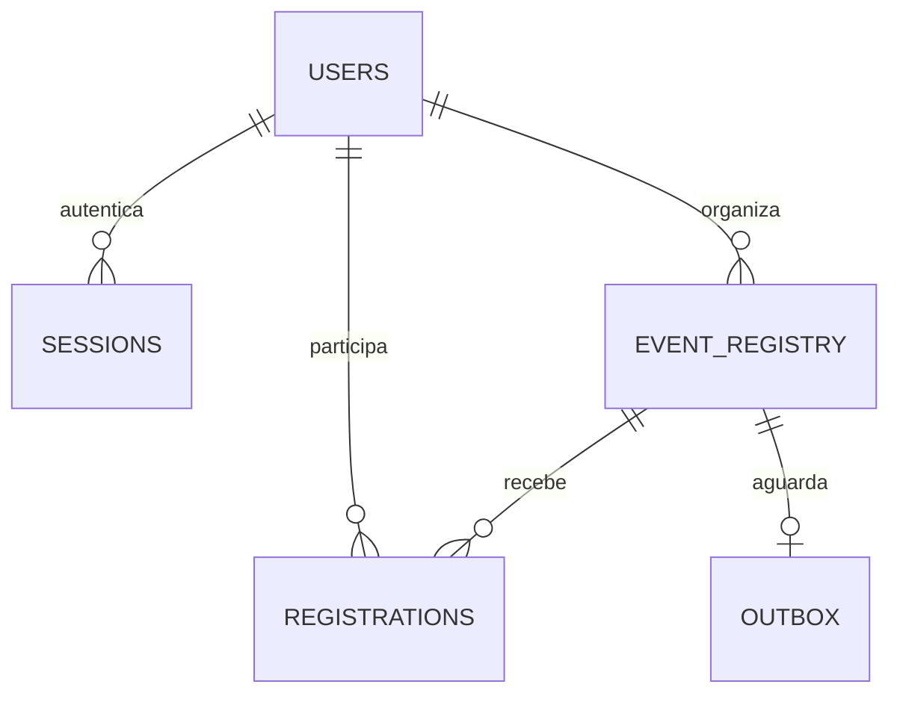

# Modelagem e operações

## MySQL (relacional)



`users.id`: UUID. `users.email`: único. `sessions.token_hash`: SHA-256 do token aleatório.
`event_registry.id`: UUID compartilhado com Cassandra. `company_id`: representação textual do ObjectId MongoDB; não é uma FK entre bancos.
`registrations`: chave composta de usuário/evento. `outbox`: no máximo uma tarefa pendente por evento.

A chave de usuário é bloqueada antes do registro de evento nas operações que exigem ambos. A transação de inscrição bloqueia a capacidade do evento antes de testar a última vaga. Cancelamento decrementa o contador na mesma transação que remove a inscrição. Exclusão com inscritos é recusada, evitando remoção silenciosa de inscrições.

## MongoDB (documentos)

Exemplo de empresa fictícia:

```json
{
  "_id": "ObjectId gerado pelo MongoDB",
  "ownerId": "UUID do usuário",
  "name": "Encontros de Tecnologia",
  "cnpj": "12345678000190",
  "description": "Eventos e oficinas para estudantes",
  "contact": "contato@example.com",
  "address": {"city": "São Paulo", "street": "Rua de Exemplo, 100"},
  "tags": ["Tecnologia", "Oficinas"]
}
```

Endereço e especialidades são embarcados no documento. Os índices únicos de proprietário e CNPJ impedem duplicações. O nome da empresa é copiado para o evento no momento da publicação: é um snapshot; editar a empresa não reescreve automaticamente todos os eventos. Salvar um evento novamente atualiza esse nome.

## Cassandra (wide-column)

```cql
SELECT payload FROM eventflow.events_by_id WHERE id = ?;
SELECT payload FROM eventflow.events_by_month WHERE month = ?;
```

A primeira consulta acessa uma partição por ID. A segunda acessa uma partição por mês, ordenada por início e UUID. `starts_at` usa ISO 8601 normalizado em UTC, com ordenação textual compatível com a cronologia. O payload é JSON serializado e o driver usa prepared statements.

### Edição de data

Se a data/hora mudar, a projeção mensal antiga é removida e a nova é inserida. Se a chave não mudar, apenas um upsert é feito: remover e reinserir a mesma chave com timestamps iguais poderia fazer o tombstone prevalecer sobre o novo dado. Há teste de regressão para esse caso.

### Persistência e replicação

Os três serviços usam volumes Docker nomeados. Cassandra utiliza RF=1 e LOCAL_QUORUM no único datacenter do ambiente local. Com RF=1, quorum equivale a uma réplica e não oferece tolerância à perda desse nó. MongoDB é standalone. Não há demonstração de cluster redundante neste projeto.

## Relação com a disciplina

| Conteúdo | Aplicação concreta |
|---|---|
| Polyglot Persistence | Escolha de três tecnologias para responsabilidades distintas |
| Modelagem por consulta | Duas projeções Cassandra para dois padrões de acesso |
| Índices | E-mail, proprietário, empresa, CNPJ e chaves de inscrição |
| Dados embarcados | Endereço e especialidades em um documento MongoDB |
| Concorrência | Bloqueio do registro de vagas e transação de inscrição |
| Recuperação | Outbox persistente com reexecução após falha |
| Otimização | Evitar consulta global no Cassandra e paginar o catálogo |

A existência de índices não significa que toda consulta será mais rápida. O otimizador, a seletividade e o volume interferem. Não foram produzidos números de desempenho; melhorias quantitativas exigem medições controladas com carga e configuração registradas.
